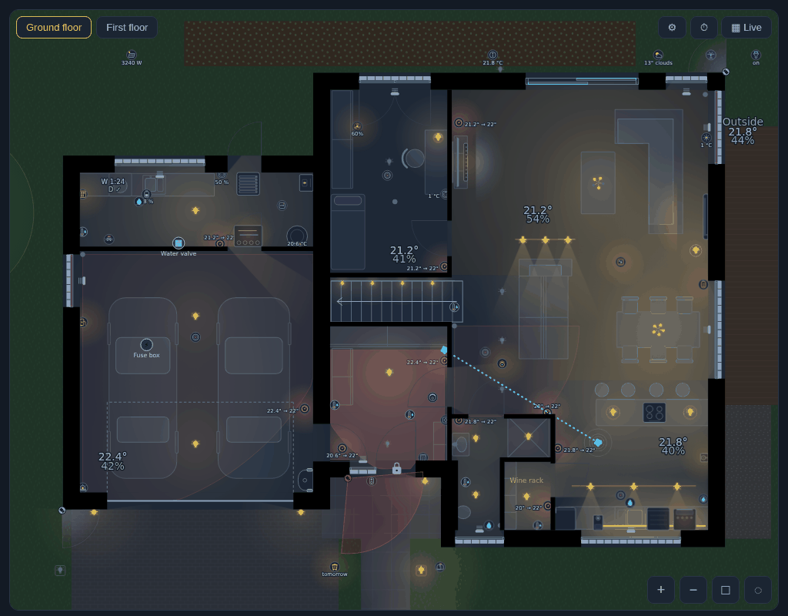
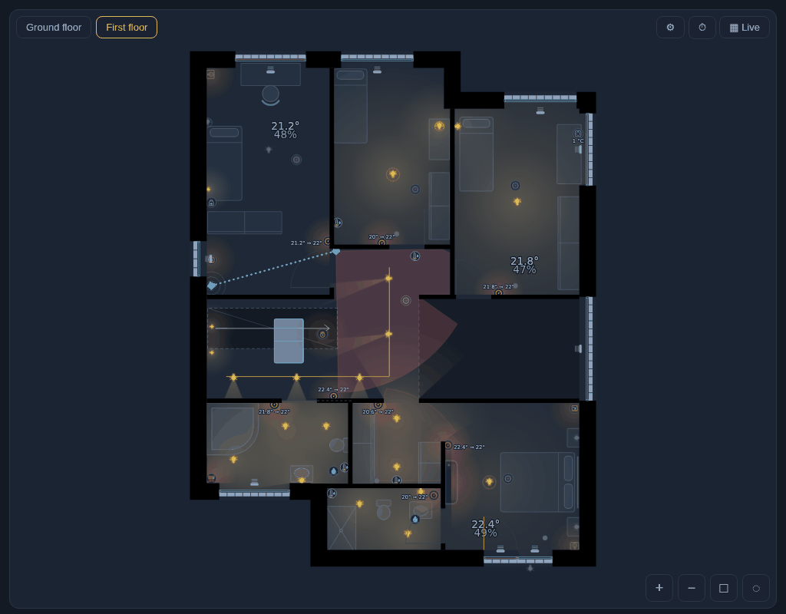
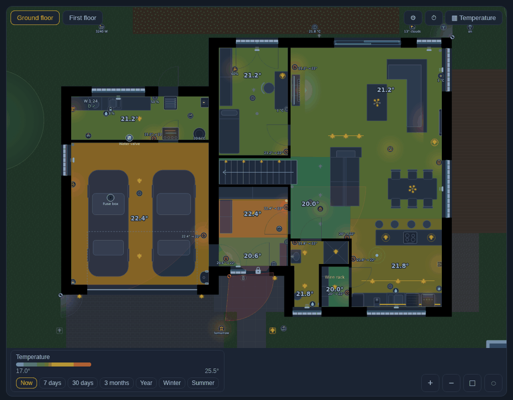
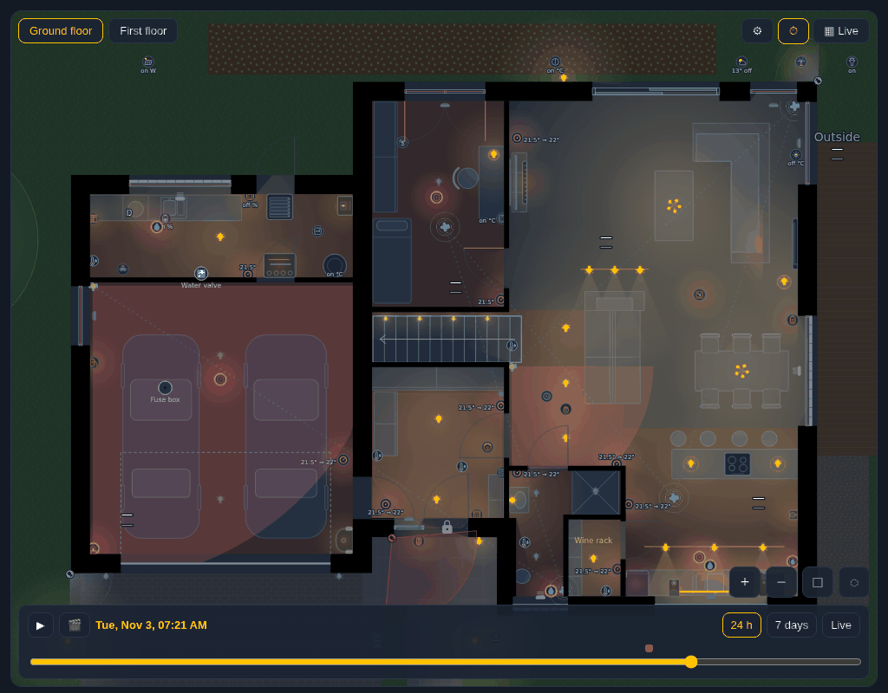
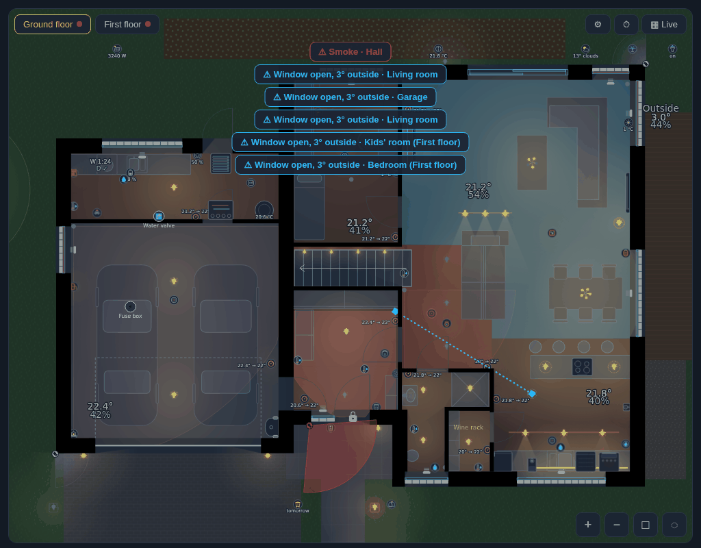
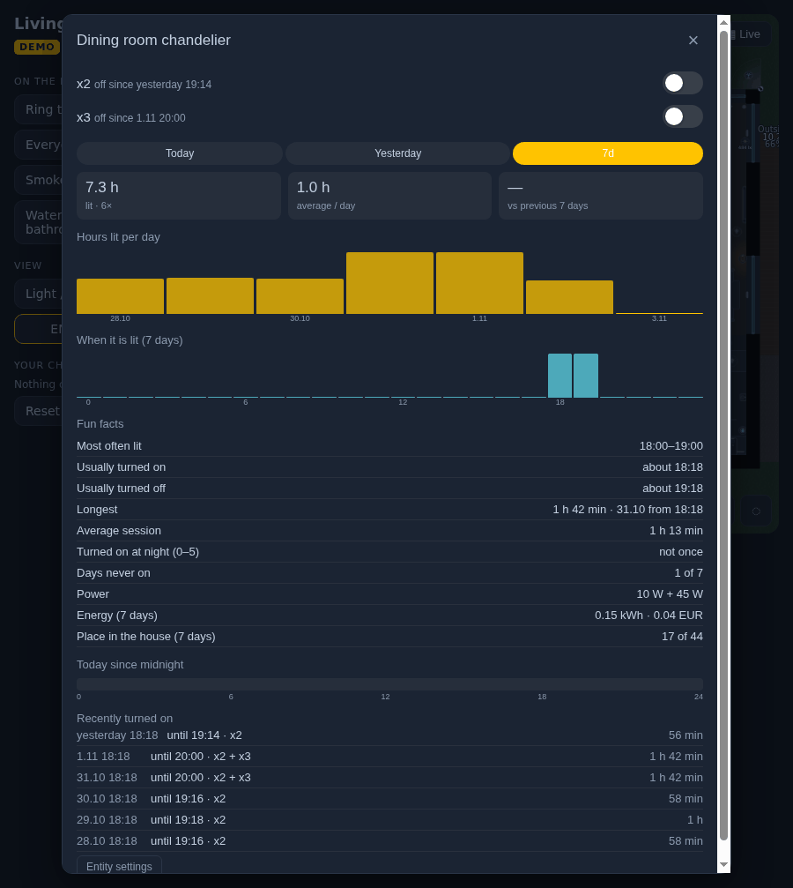
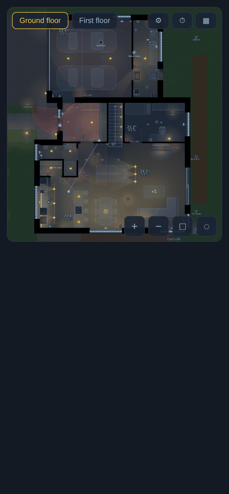
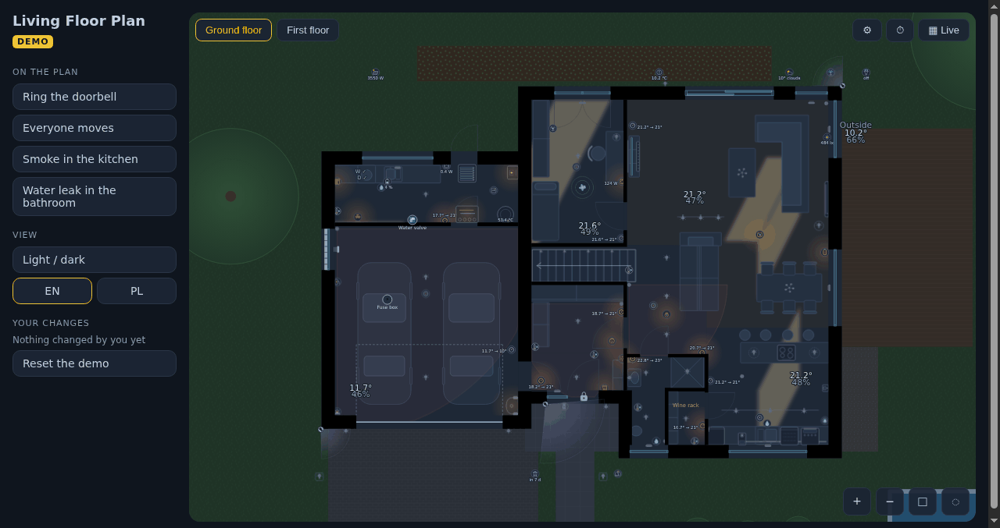

<h1><picture><source media="(prefers-color-scheme: dark)" srcset="brand/dark_logo.png"></picture></h1>

[![hacs][hacs-badge]][hacs] [![Validate][validate-badge]][validate] [![Buy Me a Coffee][bmc-badge]][bmc]

**Your house, live.** Draw your home once in the editor, then watch it on your dashboard: light from your real lamps
fills the rooms and spills through the doorways, covers move, thermostats, sensors and cameras sit where they are in
the house, and you can scroll back through its day.

One integration for Home Assistant: the **editor** is a panel in the sidebar (it keeps the plan in Home Assistant, with
versions), the **card** shows it on any dashboard.



## What it does

| | |
|---|---|
|  **Real light.** Every bulb lights what it can see: walls cast shadows, light leaks through open doors, a closed door with a contact stops it. Dimmed lamps are dimmer, coloured ones tint their light. |  **Room maps.** Rooms coloured by temperature, humidity, hours of light or presence, or by what the light cost. |
|  **Time travel.** The house at any moment of the last day or week, with play and marks for alarms, doors and cameras. 30 days and 3 months with [InfluxDB Proxy][proxy]. |  **Alerts.** Smoke, CO, gas and leaks, a window left open in the cold, your own rules - the room pulses and a banner says where. |
|  **History in one hold.** With [Entity Insights][insights]: how long a lamp was on, when, what it cost; a thermostat's hours of heating; a cover's moves. |  **Made for phones and wall tablets.** A wide plan turns on a tall screen; tablet mode dims at night and wakes on a touch or an alert. |

Also: sun through the windows, a trail of movement, cameras whose field of view turns red when they see someone,
lamps left on in empty rooms, live power by the devices, a garden round the house, floors, light and dark themes,
English and Polish.

## Try it

**[Live demo](https://demo.floorplan.stryczek.it/?utm_source=readme)** - a made-up house in a simulated home, right in your browser;
**[the editor](https://demo.floorplan.stryczek.it/editor/?utm_source=readme)** too: change the house or draw your own, then *See it live*
(nothing to install; what you switch is remembered in your browser only).



## Install

1. **HACS** → ⋮ → *Custom repositories* → this repository, type **Integration** → download → restart Home Assistant.
2. *Settings → Devices & services → Add integration → **Living Floor Plan***.
3. Open **Floor plan** in the sidebar and draw your house (or start from the example, or the Wizard).
4. Add the card to a dashboard:

   ```yaml
   type: custom:living-floorplan-card
   ```

That is all: the card loads on every dashboard by itself, and it shows the plan you saved in the editor.

## Documentation

- **[Getting started](docs/getting-started.md)** - from a blank plan to the card, in 15 minutes
- **[The editor](docs/editor.md)** - walls, openings, rooms, lights, devices, furniture, floors, the start view
- **[The card](docs/card.md)** - what you see and what a tap or a hold does
- **[Configuration](docs/configuration.md)** - every option, with examples
- **[With our other add-ons](docs/companions.md)** - Entity Insights, InfluxDB Proxy, Long-term Chart Card
- **[Troubleshooting](docs/troubleshooting.md)**
- [Developing](docs/developing.md) - building, tests, the editor on its own

## Support

If the card saves you an evening of drawing, you can [buy me a coffee][bmc] ☕ — thank you!

[hacs]: https://hacs.xyz
[hacs-badge]: https://img.shields.io/badge/HACS-Custom-41BDF5.svg
[validate]: https://github.com/stryczekk/living-floorplan/actions/workflows/validate.yml
[validate-badge]: https://github.com/stryczekk/living-floorplan/actions/workflows/validate.yml/badge.svg
[bmc]: https://buymeacoffee.com/stryczekk
[bmc-badge]: https://img.shields.io/badge/Buy%20me%20a%20coffee-stryczekk-FFDD00?logo=buymeacoffee&logoColor=black
[insights]: https://github.com/stryczekk/entity-insights
[proxy]: https://github.com/stryczekk/ha-influx-proxy
