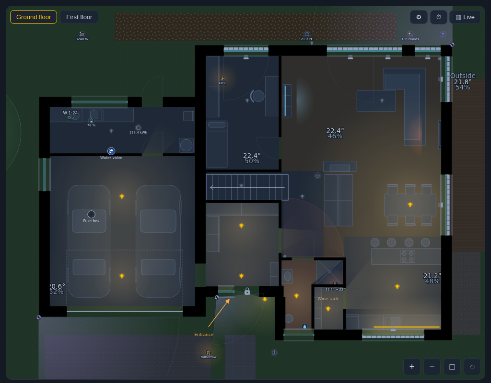
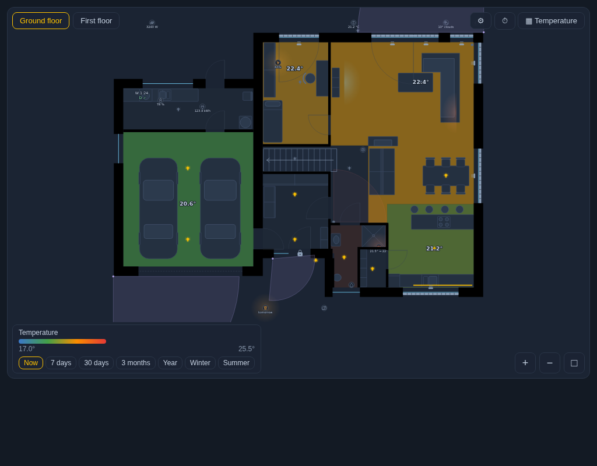
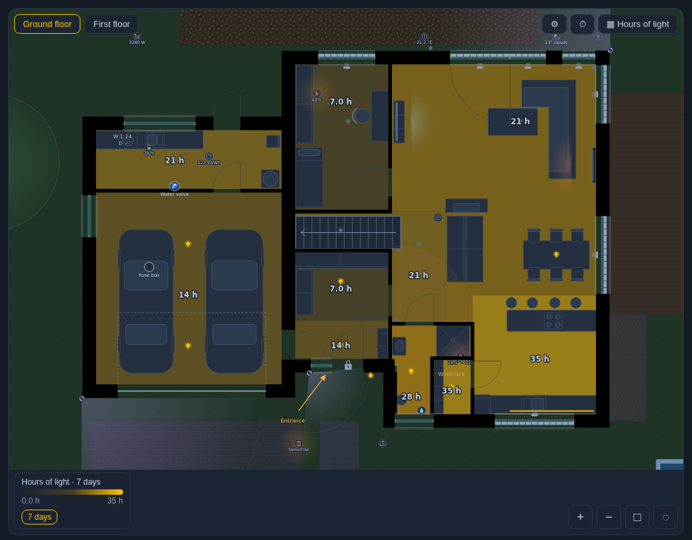
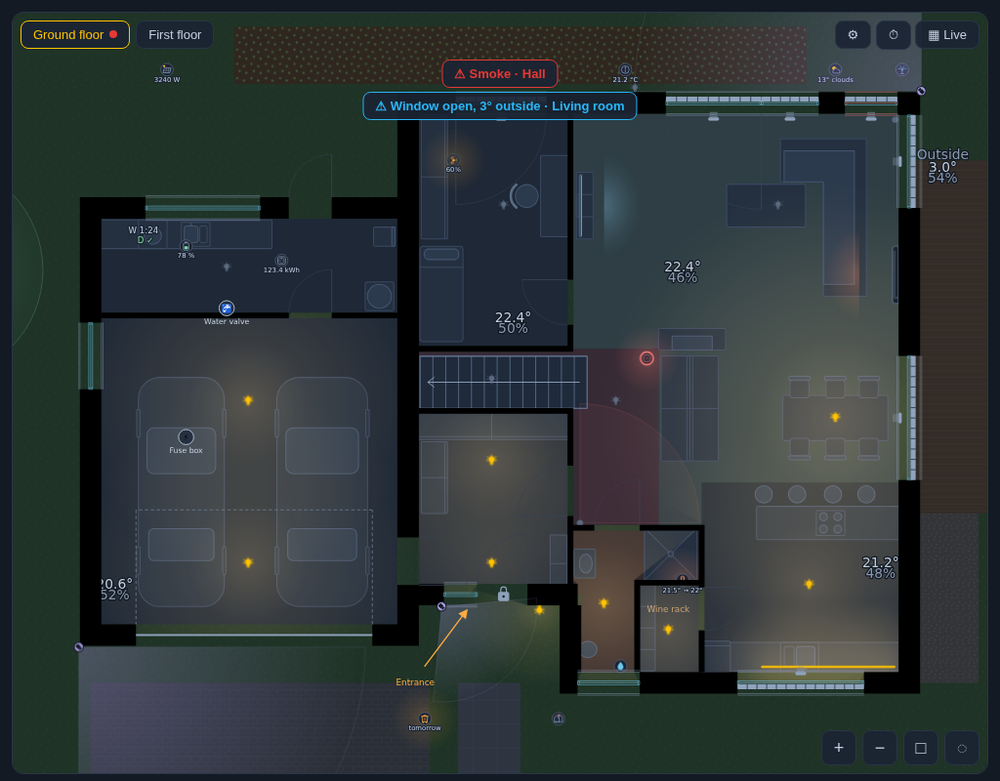
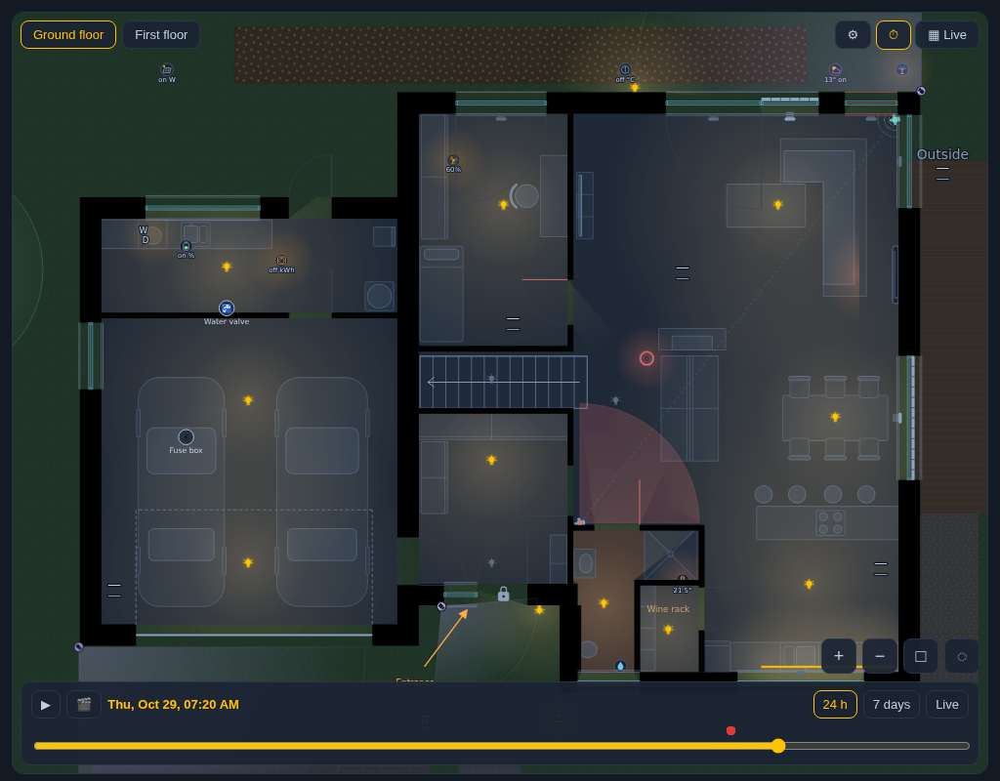
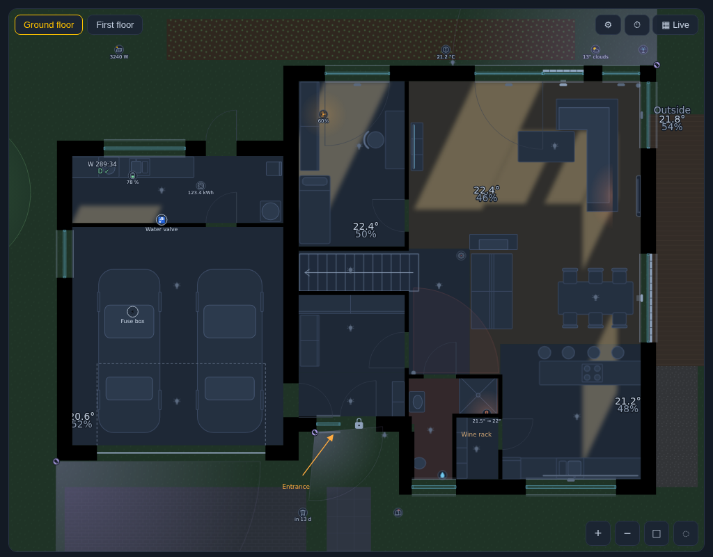
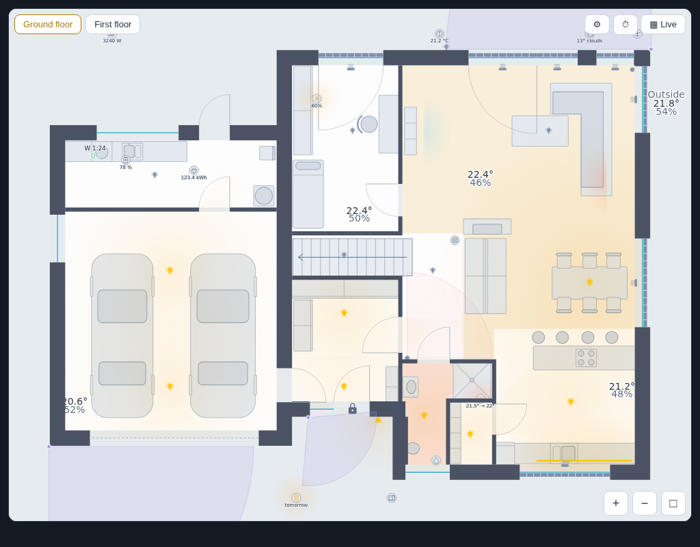
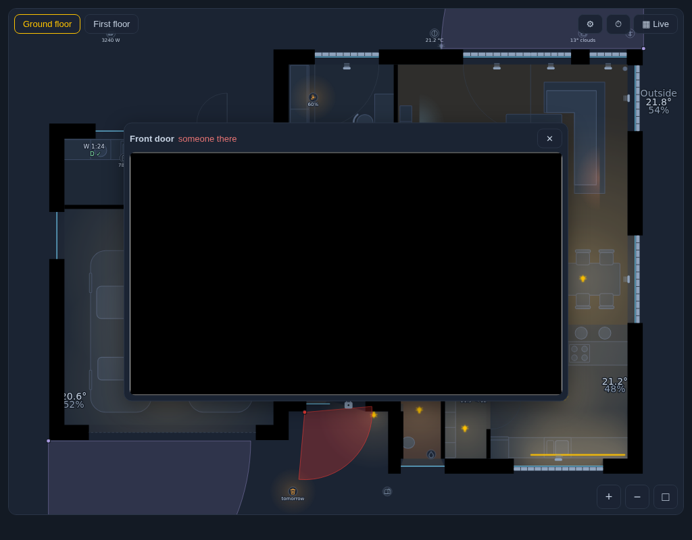

# Living Floor Plan

[![hacs][hacs-badge]][hacs] [![Validate][validate-badge]][validate] [![Buy Me a Coffee][bmc-badge]][bmc]

Your house from the [floor plan editor](../floorplan-editor) (`house.json`), live in Home Assistant:

- **light that fills the rooms** - every bulb lights what it can see: walls cast shadows, light spills through open
  doorways into the hall, a door with a contact sensor stops it when closed, an LED strip lights along its length;
  dimmed lamps are dimmer, coloured lamps (RGB, warm or cool white) tint their light
- covers, room temperature and humidity, presence and motion, door and window contacts, appliances, locks
- **room maps** - rooms coloured by temperature, humidity, hours of light / presence, or **the energy and cost of the
  light** (each lamp's `watts` from the editor x its time on) over the last days
- **time travel** - the house at any moment of the last 24 hours or 7 days, with play; **30 days and 3 months with
  [InfluxDB Proxy](https://github.com/stryczekk/ha-influx-proxy)** (also for the hours maps: 7 / 30 days / 3 months)
- **trail of movement** - where motion and presence sensors fired in the last 30 minutes, joined in order, fading
- **sun through the windows** - the patch of sunlight each window throws on the floor, now or in time travel
- **notes** - text, markers with a note (tap: the note) and arrows drawn in the editor
- **garden** - the plot round the house: lawn, terrace, driveway, paths, flower beds, pool, fence, hedge, trees
- **a day in 30 seconds** - 🎬 in time travel saves the range as an animated GIF
- **alerts** - smoke, CO and leak detectors, windows open in the cold and your own rules make the room pulse
- **tablet mode** - back to the start view when idle, dimmed at night, woken by a touch or an alert
- **⚙ settings for each viewer** (kept in the browser): light or glows, light strength, sun, trail, room names, temperatures, layers
- **heating and cooling** - the A/C glows coral or cyan by what it does, thermostats and TRVs show "21.5° → 22°" and
  tint their room while heating (floor heating included), fans spin at their speed
- **cameras** - a camera's field of view turns red when it sees someone (the person / motion sensor on the camera's own
  device is found by itself); in tablet mode its picture pops up and closes itself when things go quiet
- **marks on the time line** - alarms, doors unlocked, camera detections and your own `events`; tap one to go there
- **lamps left on** - a lamp on for half an hour in a room whose sensors saw nobody as long blinks, with a "turn off" button
- **light and dark** - follows Home Assistant's dark mode (or set `theme`), with your own `accent`
- **readings anywhere**, also outside: a waste bin with its collection day (glows the day before), mailbox, weather,
  irrigation, solar power, home battery, any value
- floors, pinch / wheel zoom and pan, a wide plan turns on a tall phone screen
- appliance labels: "W 1:25" while a washer runs (its end as a timestamp, minutes or h:mm), "D ✓" when the dryer is done
- tap toggles a light or a cover (a two-circuit chandelier cycles: off, one bulb, all), hold opens the entity dialog
  (or [Entity Insights](https://github.com/stryczekk/entity-insights) when installed)
- a visual editor in the dashboard (Home Assistant's own form); English and Polish



| | |
|---|---|
|  |  |
|  |  |
|  |  |
|  | |

## From a drawing to the card

1. **Install** through HACS as an **integration** (custom repository for now: *HACS → ⋮ → Custom repositories*, type
   *Integration*), restart Home Assistant, then *Settings → Devices & services → Add integration → Living Floor Plan*.
   One install: the card is loaded on every dashboard (no resource to add) and the **editor** is a panel in the sidebar
   (*Floor plan*, administrators only).
2. **Open the editor** from the sidebar. It signs in with your Home Assistant login: entity fields suggest your entities,
   and *live* shows their states on the plan.
3. **Draw** the walls (click the corners, type lengths) or start with the **Wizard** ("a house in 5 minutes"), or from a
   shape; put a photo or a scan of your plan under it (*Underlay*, scaled by two points a known distance apart). Add
   openings, let the rooms fill in from the walls, place lights, covers, sensors, cameras and furniture, and pick their
   entities.
4. **Save**: the plan is kept in Home Assistant, as versions (a note each; *Save as new version* keeps the old one, a
   version can be opened again). Nothing to copy.
5. **Add the card** to a dashboard - no options needed: `type: custom:living-floorplan-card`. A save in the editor redraws
   it right away; administrators get *✎ Edit the plan* in its ⚙ menu.

Without the integration the card works from a file too: `model: /local/house.json` (the editor page then saves by
downloading `house.json`, to be put into `/config/www/`).

## Configuration

```yaml
type: custom:living-floorplan-card
model: /local/house.json          # the editor's model, in /config/www
```

| Option | Default | |
|---|---|---|
| `model` | the integration's plan | URL of `house.json` (or the model object itself) instead of the plan kept by the integration; with neither, the card shows the way to the editor |
| `doors` | `closed` | doors without a contact sensor stop the light; `open` - light goes through every doorway |
| `light` | `realistic` | `glow` - round glows clipped to the room, as the editor's SVG |
| `rotate` | `auto` | `0` / `90` - turn the plan; `auto` turns a wide plan on a tall screen |
| `floor` | ground floor | floor shown on load (a floor `id` from the model) |
| `height` | from the plan | card height in px |
| `show_floors`, `show_zoom` | `true` | the floor buttons, the zoom buttons |
| `show_room_names` | `false` | room names on the plan |
| `hold_action` | `insights` | `more-info` - always the standard entity dialog |
| `maps` | `true` | the map button; `map` - the map on load (`temperature`, `humidity`, `light_hours`, `presence_hours`) |
| `map_days` | `7` | days of history for the hours maps (the recorder keeps 10 by default) |
| `time_travel` | `true` | the ⏱ button |
| `price` | — | electricity price per kWh: the light energy map shows money (currency from Home Assistant) |
| `lock_action` | `more-info` | `hold` - a lock or door strike on the plan opens after holding it 0.8 s (a tap never opens it) |
| `influx` | `true` | use InfluxDB Proxy for history beyond the recorder when it is installed; `false` - never |
| `alerts` | — | `[{ entity, state?, above?, below?, room?, color?, name? }]` - extra alerts; the room comes from where the entity is on the plan, or `room` |
| `cold` | — | `{ outside: sensor.outdoor_temperature, below: 12 }` - a window with an open contact pulses blue when it is colder outside |
| `hide` | — | layers hidden on load: `idle_lights` (lamps that are off - still tappable), `sensors`, `devices`, `cameras`, `furniture`; each viewer can switch them in ⚙ |
| `editor_url` | the editor from HACS | where "Open the editor" leads when there is no model yet |
| `trail`, `trail_minutes` | `true`, `30` | the trail of movement |
| `sun` | — | `true` or `{ offset: -12 }` - patches of sunlight through the windows (from the home's latitude / longitude and the facades in the model; `offset` = how many degrees the house is turned from them); also in time travel |
| `kiosk` | — | `{ idle: 60, night_dim: "22:00-06:00" or sun, dim: 0.4 }` - tablet mode |
| `theme` | `auto` | `dark` / `light`; `auto` follows Home Assistant's dark mode; each viewer can change it in ⚙ |
| `accent` | yellow | `#rrggbb` for the selected buttons and the time line |
| `camera_popup` | `kiosk` | a camera that sees someone shows its picture: `kiosk` - in tablet mode, `always`, `never` (the red field of view is always there) |
| `camera_popup_seconds` | `30` | the picture closes this long after the sensor goes quiet |
| `camera_detect` | found | `{ camera.x: binary_sensor.y }` - when the person / motion sensor is not on the camera's device; the editor has a field for it too |
| `events` | alarms, locks, cameras | `[{ entity, state?, above?, below?, name?, color? }]` - more marks on the time line; `false` - none |
| `forgotten` | `{ minutes: 30 }` | a lamp on this long in a room whose presence / motion sensors were quiet as long; `false` - off. Rooms without a sensor are never judged |
| `entities` | — | your own actions per device: `{ light.x: { tap_action: {...}, hold_action: {...} } }` (or a list with `entity`) - Home Assistant's actions: `more-info`, `toggle`, `perform-action`, `navigate`, `url`, `fire-dom-event` (gets the `entity_id`), `none`, with `confirmation`. A camera answers to either of its streams, a chandelier to either circuit, a room's reading to its temperature sensor |
| `widgets` | — | `[{ type: clock \| calendar \| state \| button, entity?, attribute?, name?, icon?, tap_action?, hold_action?, at? }]` - a clock, the next calendar event, a reading (the weather as "13° clouds"; `attribute` shows one of its attributes), a button (a scene or script turns on, anything else toggles; your own action with `tap_action`). In a bar under the plan; with `at: [x %, y %]` on the plan instead (mind the card's own buttons on a phone) |
| `show_version` | `false` | a small label at the bottom with the version and the `?v=` the browser loaded (for testing) |
| `room_tap` | `dialog` | a tap on a room's empty floor opens the room: temperature with the last 24 h, presence, its lights (tap to toggle, all off), the covers of its windows (▲ ■ ▼, all up / down) and its other devices; `none` turns it off |
| `lasso` | `true` | a ◌ button by the zoom (or Shift + drag with a mouse): draw round a part of the house, then turn on / off its lights or move its covers |
| `rules` | — | `[{ entity, state? \| above? \| below?, attribute?, for? (minutes), color?, blink?, room?, target? }]` - quiet looks while something holds: the entity's room tinted (a sensor not drawn, or `room`), its mark glowing in `color` and / or blinking. E.g. CO₂ above 1000 → the room orange; a window open for 15 min → it blinks |
| `power` | auto | live power by the devices: a power sensor (W / kW) of the mark's own HA device is shown by it (`⚡350 W`), and the devices added up in a corner; `{ <entity on the plan>: <power sensor> | [<sensors>] }` sets them by hand (a list is added up), `false` hides it |
| `power_total` | — | the house's own power meter for the corner (instead of the devices added up) |
| `power_min` | `2` | below this many W a device shows no label (standby) |
| `room_heating` | `true` | a room with a thermostat or a TRV on the plan (and no colour of its own) is tinted while it heats |

## How it works

The card bundles the editor's generator: it builds the same SVG in the browser, so a change in the editor is one file to
copy. The light field is computed once per floor (a visibility polygon from every bulb against the walls, windows and
closed doors, filled with a radial gradient) and only its opacity follows the states; a door contact rebuilds it.
Lights with `watts` in the model reach a little further when brighter.

## Develop

    npm install
    npm run build                  # dist/living-floorplan-card.js
    npm test                       # geometry, maps, timeline, tablet mode
    tests/browser/run.sh --shots   # 109 checks in headless Chromium on the example house, docs/*.png
    tools/sync-generator.sh        # the generator and the editor from ../floorplan-editor
    node tests/browser/run-webkit.mjs .   # the same checks in WebKit (Safari) as an iPhone and an iPad (needs playwright + webkit)

`examples/house.json` is the example house from the editor (two floors and a garage). Status: 0.1, local only.

## Support

If the card saves you an evening of drawing, you can [buy me a coffee][bmc] ☕ — thank you!

[hacs]: https://hacs.xyz
[hacs-badge]: https://img.shields.io/badge/HACS-Custom-41BDF5.svg
[validate]: https://github.com/stryczekk/living-floorplan/actions/workflows/validate.yml
[validate-badge]: https://github.com/stryczekk/living-floorplan/actions/workflows/validate.yml/badge.svg
[bmc]: https://buymeacoffee.com/stryczekk
[bmc-badge]: https://img.shields.io/badge/Buy%20me%20a%20coffee-stryczekk-FFDD00?logo=buymeacoffee&logoColor=black
