# The card

```yaml
type: custom:living-floorplan-card
```

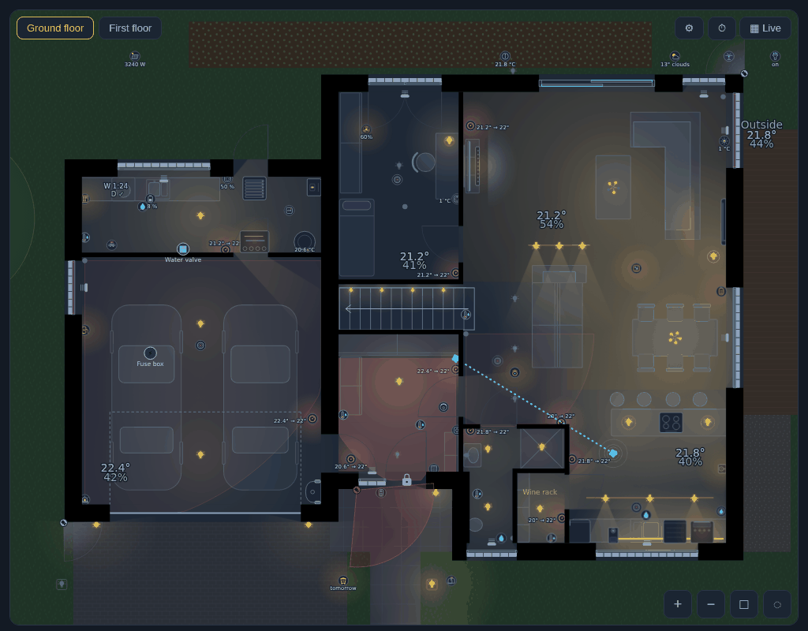

## Tap, hold - what happens

One rule, so you always know:

| | Tap | Hold |
|---|---|---|
| **Light, chandelier, cover** | switches it (a chandelier: off → its smaller circuit → off; a cover: opens, closes, a moving one stops) | details / history |
| **Anything else** (sensors, thermostats, appliances, TV, cameras, the rack...) | details | details / history |
| **Lock / door strike** | details - a tap never opens a door | details, or with `lock_action: hold` **opens it** after 0.8 s |
| **A room's empty floor** | the room: its temperature with the last 24 h, its lights, covers and devices | - |

- Holding shows a ring filling under your finger; let go early and nothing happens. Red ring = it will open a door.
- After every tap that switched something, a bar at the bottom says what it did, with **Undo** (6 s): the lamp comes
  back as it was (with its brightness), the cover goes back to its position.
- With a mouse, a hint follows the pointer: *Click: turn on · hold: statistics*.
- "Details" is Home Assistant's own entity dialog - or the history dialog of [Entity Insights](companions.md#entity-insights)
  when it is installed. Your own actions per device: [`entities`](configuration.md#your-own-actions).

## The light

Each bulb lights what it can see from where it is: walls cast shadows, light goes through open doorways, a door with
a contact sensor stops it when closed (`doors: open` lets it through doors without a sensor). Dimmed lamps are dimmer,
coloured and white-temperature lamps tint their light. `light: glow` draws simple round glows instead.

| | |
|---|---|
| 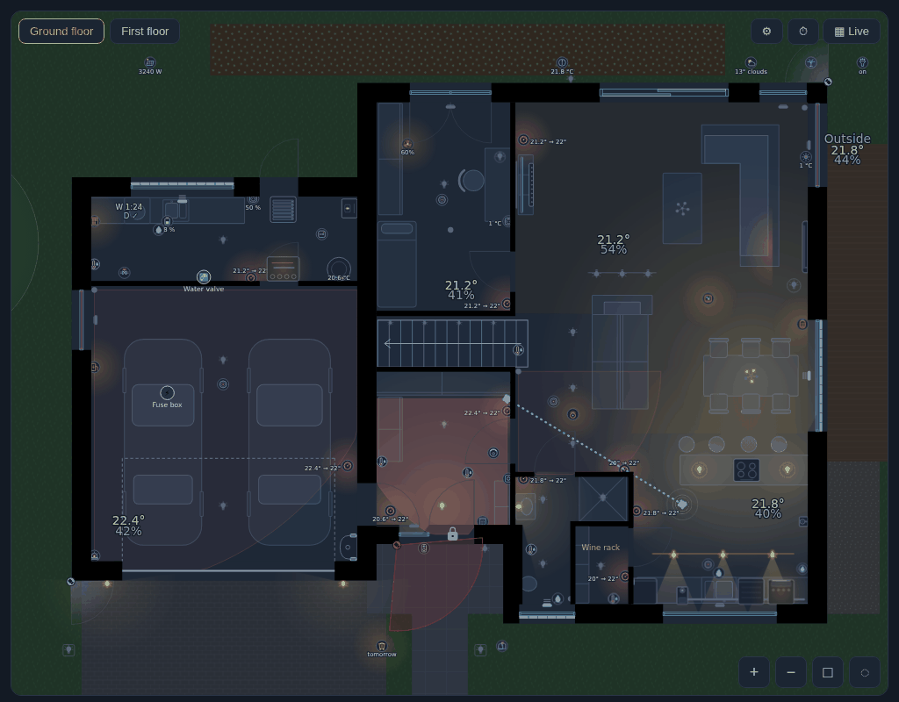 | 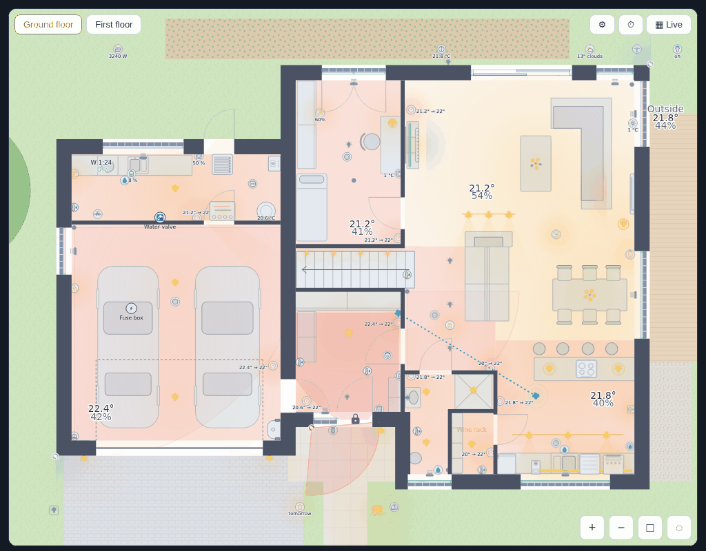 |

## Readings and devices

- **Room readings**: temperature and humidity where you put them; **thermostats** "20.5° → 21°", coral while heating,
  cyan while cooling; plugs and devices with their power. Readings next to an icon stay off the walls by themselves.
- **Appliances**: a running washer shows "W 1:25" (time to the end), a finished dryer "D ✓"; the fridge door, the
  dishwasher, the oven.
- **Covers** as a band across the window, as deep as they are closed; a moving one blinks an arrow up or down the
  screen.
- **Cameras**: their field of view, red while they see someone (the person / motion sensor on the camera's own device
  is found by itself); in tablet mode the picture pops up.
- **Heating rooms** are tinted while their thermostat or TRV heats (`room_heating`, also switchable in ⚙).

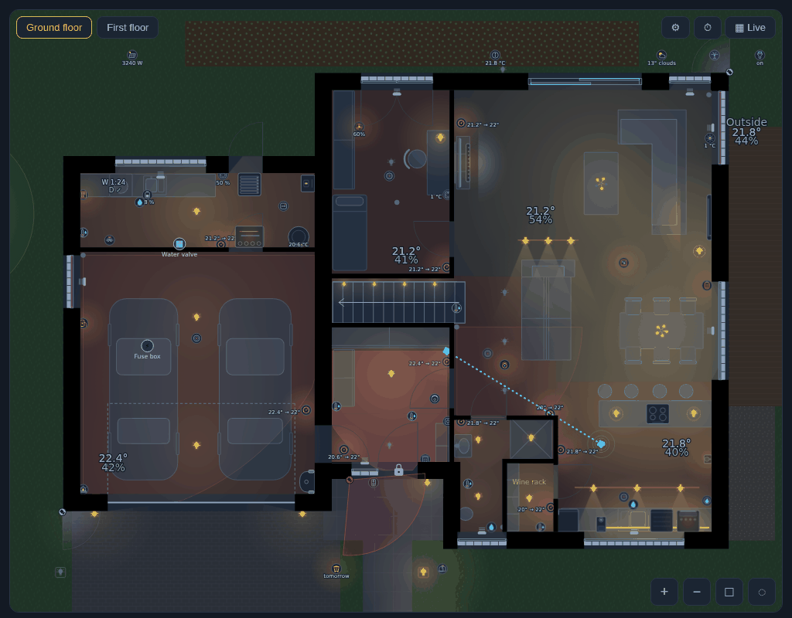

| | |
|---|---|
| 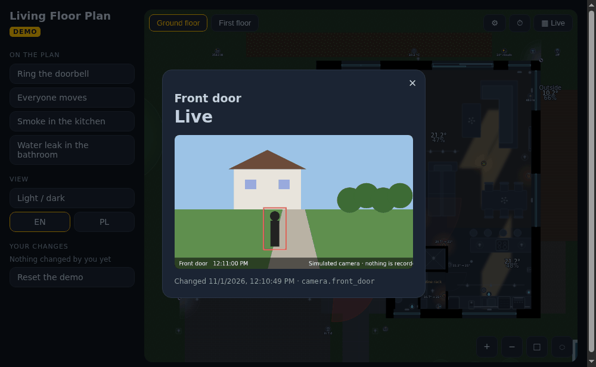 | 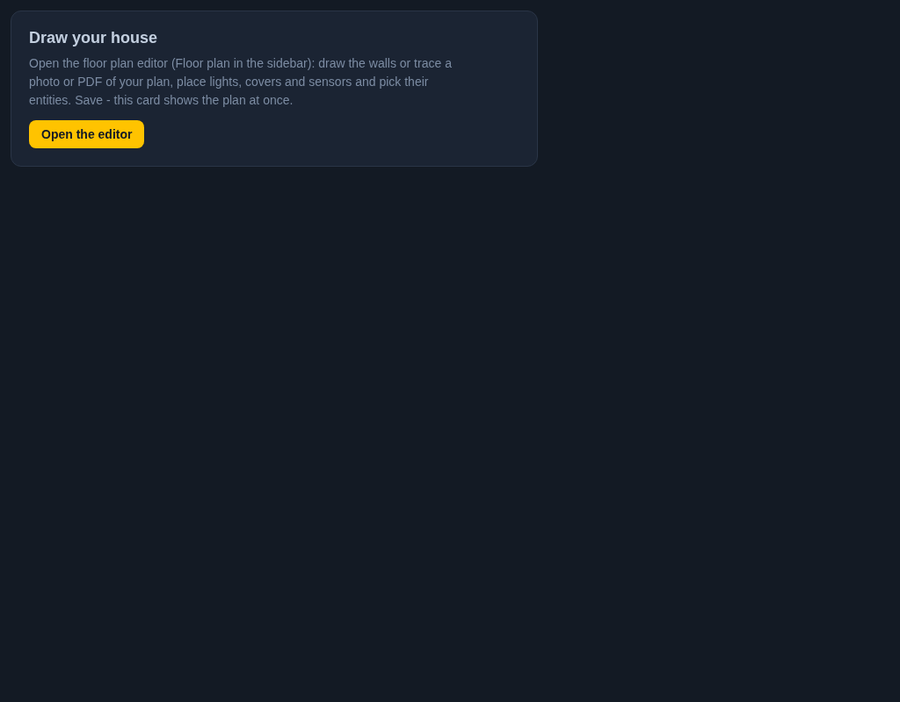 |

## Maps

▦ on the top bar: rooms coloured by **temperature**, **humidity**, **hours of light**, **hours of presence**, **the
energy and cost of the light** (each lamp's `watts` × its time on, with `price`), **all the energy in the rooms** (from
the devices' meters) or **signal** (Zigbee / Wi-Fi of the devices). Now, or over 7 / 30 days, 3 months,
a year (the longer ones with [InfluxDB Proxy](companions.md#influxdb-proxy)).

| | |
|---|---|
| 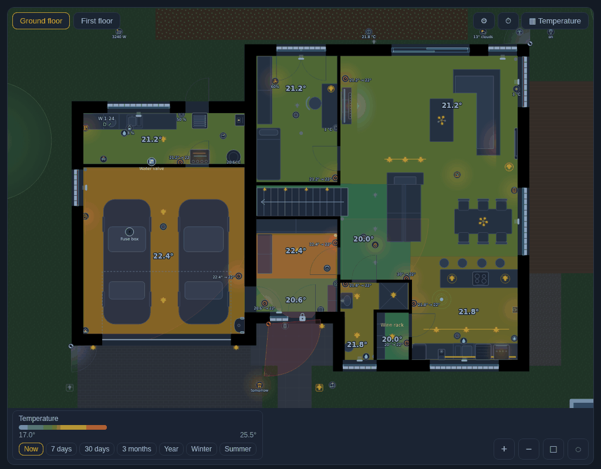 | 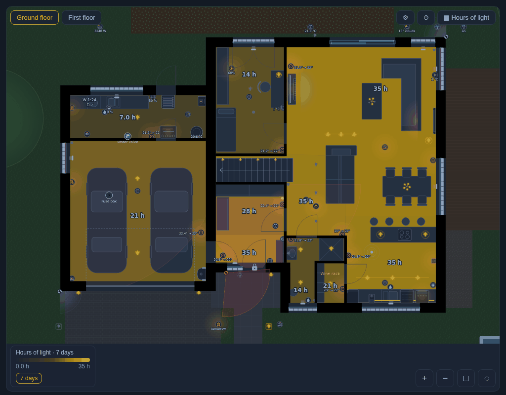 |

## Time travel

⏱: drag through the last 24 hours or 7 days (30 days and 3 months with InfluxDB Proxy); ▶ plays it; marks on the line
for alarms, doors unlocked, camera detections and your own `events` - tap one to go there. 🎬 saves the range as an
animated GIF ("a day in 30 seconds").

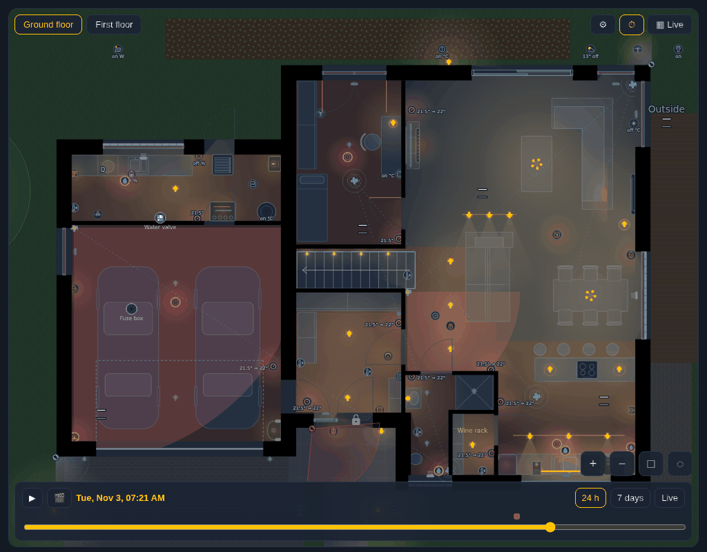

## Alerts and rules

Smoke, CO, gas and leak detectors make their room pulse and a banner says where (also from another floor). A window
open while it is cold outside (`cold`), and your own [`alerts`](configuration.md#alerts) and [`rules`](configuration.md#rules)
(a room tinted while CO₂ is high, a window blinking when open for 15 minutes...).

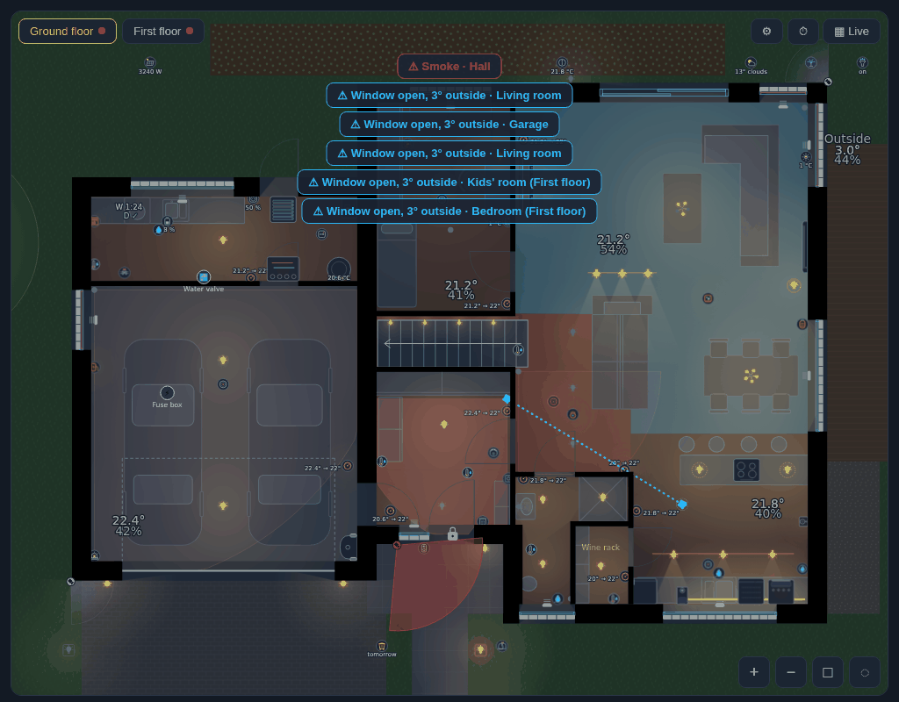

## More

- **Sun through the windows** (`sun`): the patch of sunlight each window throws on the floor, now or in time travel.
- **Trail of movement**: where motion and presence sensors fired in the last 30 minutes, joined in order.
- **Lamps left on**: a lamp on for half an hour in a room whose sensors saw nobody blinks, with a *turn off* button.
- **Live power** (`power`): a device's power by its mark, the house's total in a corner.
- **Lasso** (◌): draw round a part of the house, then switch its lights or move its covers at once.
- **Floors** (buttons on the top), **zoom** (wheel, pinch, + −, □ back to the start view), **light / dark** following
  Home Assistant (or `theme`).
- **Tablet mode** (`kiosk`): back to the start view when idle, dimmed at night, woken by a touch or an alert.

| | |
|---|---|
| 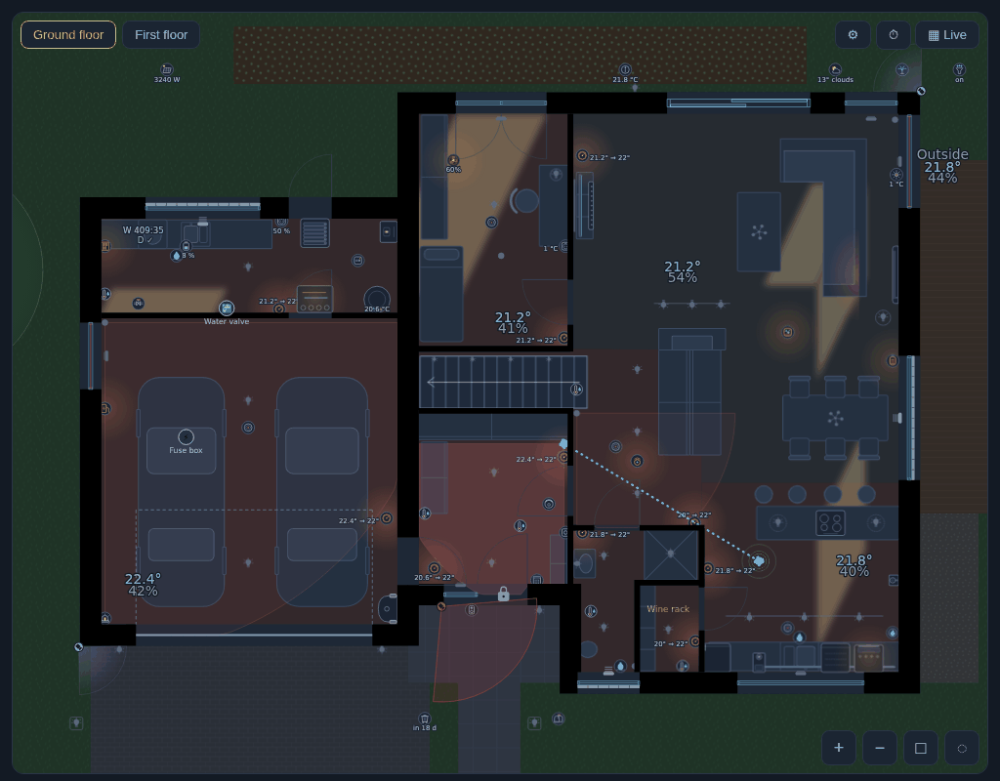 | 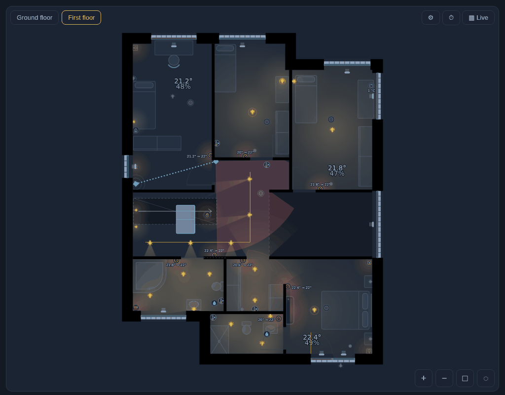 |

## ⚙ - each viewer's own settings

Kept in the browser, on top of the card's options: light (realistic / glows) and its strength, theme, sun, trail,
room names, temperatures, **heating rooms tinted**, and the layers (lamps that are off, sensors, devices, cameras,
furniture). *Reset* goes back to the card's options.
