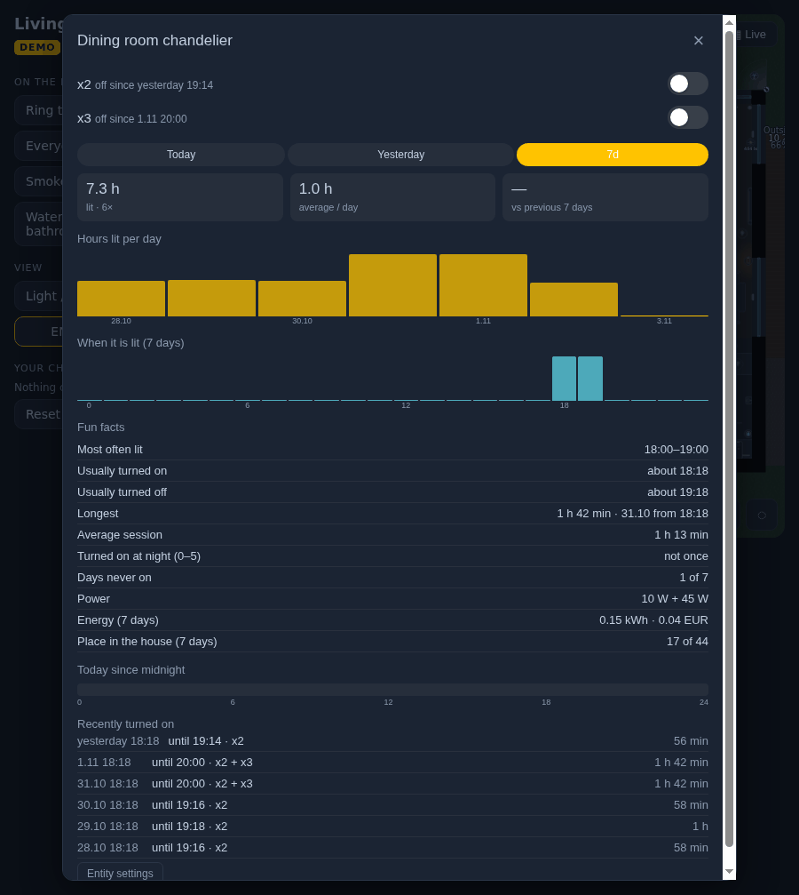
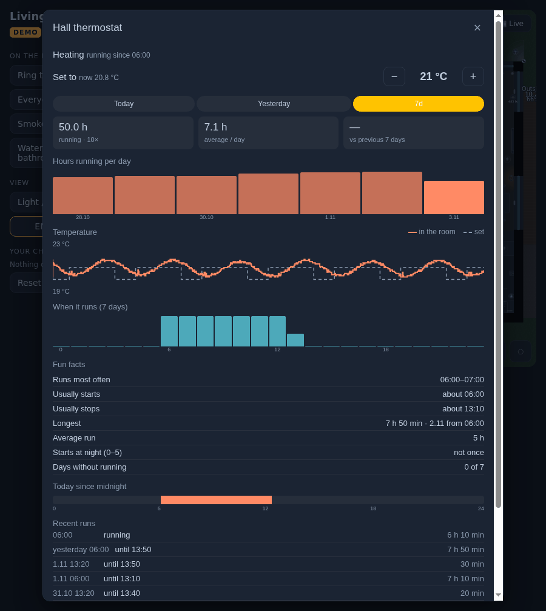
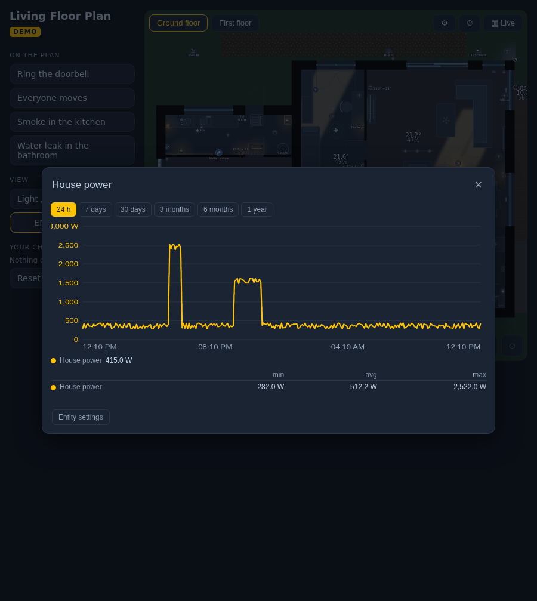

# With our other add-ons

Living Floor Plan works on its own. Three free add-ons by the same author make it more: history behind every hold,
months of history instead of days, and charts for the sensors. Each is in HACS and each is optional - the card notices
them by itself.

| Add-on | HACS type | What it adds to the floor plan |
|---|---|---|
| [Entity Insights](https://github.com/stryczekk/entity-insights) | Dashboard | the **history dialog** behind a hold (and, if you want, behind every tap that opens details) |
| [InfluxDB Proxy](https://github.com/stryczekk/ha-influx-proxy) | Integration | **30 days and 3 months** in time travel, the maps and the history dialogs |
| [Long-term Chart Card](https://github.com/stryczekk/long-term-chart-card) | Dashboard | **charts** of numeric sensors in the history dialog, and a chart card for your dashboard |

## Entity Insights

**What you get.** Hold a lamp on the plan: how long it was on today, this week, in three months; at what hours; when it
is usually turned on and off; the longest session; its energy and what it cost; its place among the lights of the house.
Hold a cover: how long it stayed closed, who moved it (an automation, a person, Google Assistant, a wall button). A
thermostat (0.11+): hours of heating or cooling, the room's temperature against the set one, with − / + to change it.
A lock, the alarm, a player, a robot: when and how long. A sensor of words (a washer's program): time in each state.

| | | |
|---|---|---|
|  |  |  |

**Install**: HACS → search **Entity Insights** → download → refresh the browser. Nothing to configure for the floor
plan: from now on **a hold** on the plan opens it.

The floor plan passes it what the plan knows:

- **power** of each lamp (`Power (W)` in the editor) → the energy and cost of that lamp;
- **price** of a kWh (the card's `price`) → what it cost;
- a **two-circuit chandelier** → one dialog for both circuits, each with its switch, titled by the chandelier's name;
- the **lights on the plan** → "place in the house" ranks among them (not among every light entity you have).

```yaml
type: custom:living-floorplan-card
price: 0.30            # → "Energy (7 days): 1.2 kWh · 0.36 EUR" in the dialogs
```

**Also on a tap.** A tap on anything that is not a light or a cover opens its details - Home Assistant's own dialog by
default. To get the history dialog there too, add Entity Insights' invisible card to the same dashboard, with the
domains it should take over:

```yaml
- type: custom:entity-insights
  more_info: [binary_sensor, sensor, climate, lock, media_player, switch, fan]
  recorder_days: 10      # your recorder's purge_keep_days
  price: 0.30
```

The dialog always has a button for Home Assistant's own one (*Entity settings*).

To always get Home Assistant's dialog on a hold instead: `hold_action: more-info`.

## InfluxDB Proxy

Home Assistant's recorder keeps about 10 days. If you also write your history to **InfluxDB** (the `influxdb`
integration), InfluxDB Proxy lets the dashboard read it back:

- **time travel**: 30 days and 3 months besides 24 h and 7 days;
- **maps** (hours of light / presence, energy, temperature): 30 days, 3 months, a year;
- **Entity Insights**: 30 days and 3 months.

**Install**: HACS → **InfluxDB Proxy** (an integration) → restart → *Add integration* → your InfluxDB (1.8, 2.x, 3, or
VictoriaMetrics). Nothing to set on the card: it finds the proxy by itself (`influx: false` turns it off).

```yaml
type: custom:living-floorplan-card
map: light_hours
map_days: 30             # beyond the recorder: from InfluxDB through the proxy
```

## Long-term Chart Card

- **In the history dialog**: Entity Insights draws numeric sensors (temperature, power, CO₂...) with it - with ranges
  from 24 h to a year and a min / average / max table. Without it installed, a sensor opens Home Assistant's own dialog.
- **On your dashboard**, next to the plan - e.g. the rooms' temperatures with the heating's periods:

```yaml
type: custom:long-term-chart-card
title: Rooms
days: 7
entities:
  - entity: sensor.living_temperature
  - entity: sensor.bedroom_temperature
events:
  - entity: climate.living
    attribute: hvac_action
    states: [heating]
    name: Heating
```

## A dashboard with all of them

A sections view: the plan full width, the charts under it.

```yaml
views:
  - title: Home
    type: sections
    max_columns: 4
    sections:
      - column_span: 4
        cards:
          - type: custom:living-floorplan-card
            price: 0.30
            lock_action: hold
          - type: custom:entity-insights          # invisible: the history dialog for these on a tap too
            more_info: [binary_sensor, sensor, climate, lock, media_player]
            price: 0.30
      - column_span: 2
        cards:
          - type: custom:long-term-chart-card
            title: Temperatures
            days: 7
            entities: [sensor.living_temperature, sensor.bedroom_temperature, sensor.outside_temperature]
      - column_span: 2
        cards:
          - type: custom:long-term-chart-card
            title: Power
            days: 1
            entities: [sensor.house_power, sensor.solar_power]
```
