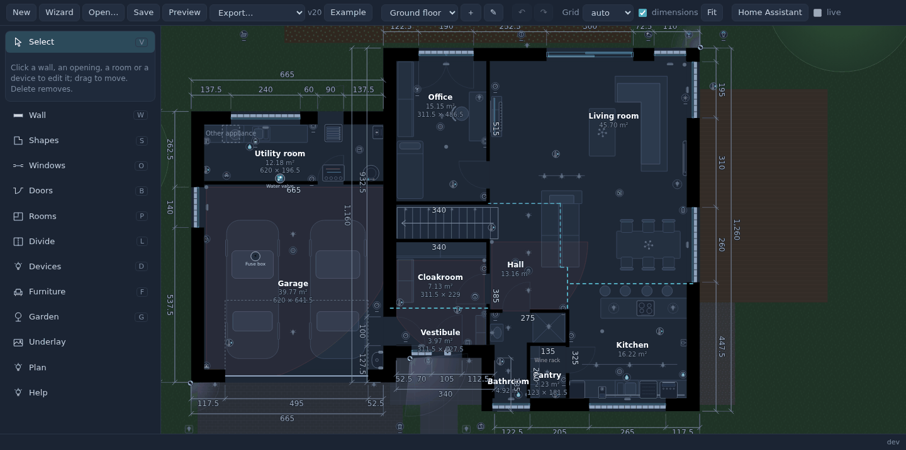
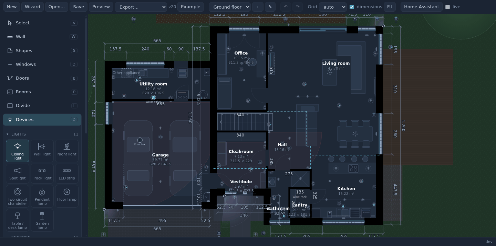
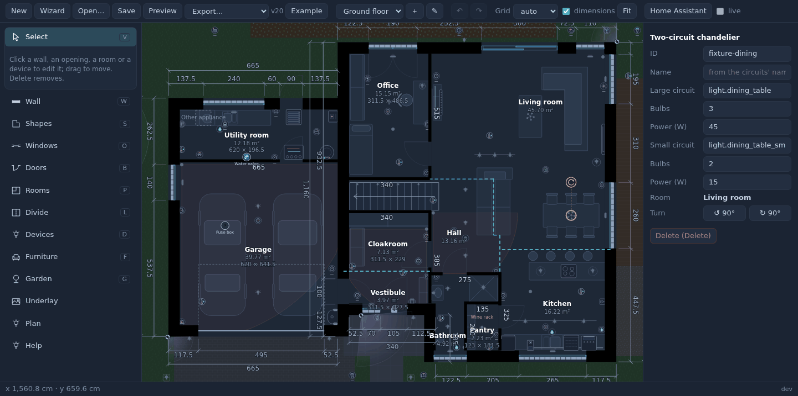
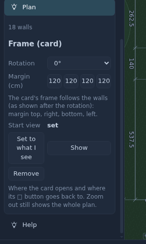

# The editor

**Floor plan** in the sidebar (administrators). It works on the plan kept in Home Assistant and signs in with your
login: entity fields suggest your entities, and **live** (top bar) shows their real states on the plan while you draw.

The tools are on the left (with their keys); what you select shows its properties on the right. Ctrl / Cmd + Z undoes,
Ctrl / Cmd + Shift + Z redoes, each floor with its own history.

## Walls - W

- Click the corners; type a length while drawing to set it exactly. Shift: any angle.
- **Shapes** (S): a rectangle, an L, a U as walls in one go. **Wizard**: a house from its rooms' sizes.
- Wall types (exterior, load-bearing, partition, chimney) with their thickness are set in the tool.
- A wall that ends on another wall joins it - also when it stops a little short of its centre line or runs a little past
  it: the plan draws it to the other wall's face, so no gap is left. A wall laid over another one, or continuing it in
  line, merges with it.
- Dimensions along the walls and from the building's corners (toggle *dimensions*).

## Windows - O, doors - B

- **Windows**: panes (their sizes and which open), sliding (HST), balcony doors, a **corner window** that turns round a
  corner (a length on each wall).
- **Doors**: single (hinge side, swing), double, sliding, pocket, garage (sectional), gates, passages without a door.
- Per opening: its **cover** (a window's roller blind - the card moves it), its **contact sensor(s)** (one per pane that
  opens). A door's contact tells the card when the door is shut: a shut door stops the light.

## Rooms - F, dividers - L

Rooms are found from the walls. Click one to give it a **name** (its id follows), a **floor** pattern and colour, mark it
**unused** (a void, the space under a roof slope). In an open space a **divider** line splits it into rooms; a divider
can *stop the light* (a glass wall) or let it through.

## Devices - D

| Group | Kinds |
|---|---|
| Lights | ceiling, wall, night light, spotlight, track rail (any shape, bulbs along it), LED strip, **two-circuit chandelier**, pendant, floor / table / garden lamp |
| Sensors | presence, motion (with its field of view), temperature & humidity, smoke, CO, leak, gas, air quality, illuminance, vibration, button |
| Security | camera (field of view, a second stream, the person sensor), doorbell, lock, gate, alarm panel, keypad, siren, NVR |
| Climate | A/C, thermostat, TRV, radiator, floor heating, recuperator, boiler, heat pump, water tank, fireplace, fan, purifier, (de)humidifier |
| Outside | waste bin (collection day), mailbox, intercom, irrigation, rain, pool pump, weather |
| Energy | meter, fuse box, solar, inverter, battery, UPS, EV charger, plug, power strip |
| Appliances | fridge (also side by side), freezer, dishwasher, oven, cooktop, microwave, hood, coffee machine, washer, dryer, **washer + dryer stacked**, wine fridge, vacuum, mower |
| Audio & video | TV (by its diagonal), soundbar, media player, amplifier, set-top box, projector, console, printer |
| Network | **rack** (drop routers, switches, a NAS... into it), router, switch, access point, NAS, Zigbee coordinator |
| Notes | text, a marker with a note, an arrow |

- Pick a kind and click where it goes; it shows under the pointer before you click. Near a wall it turns its back to it
  (Alt while dragging: always to the wall, Shift: exactly where you point). R turns it.
- Each one asks for the entities it needs - e.g. a thermostat its `climate` entity and, optionally, a separate
  temperature sensor; a plug its switch and its power sensor (its reading is shown by it).

### Lights

A **light is a circuit**: one entity, its bulbs where they are. Shift + click adds a bulb to the selected circuit;
*Merge* joins lamps into one circuit, *Take out* splits a bulb off. Each bulb has its own direction and beam angle
(spotlights, wall lights). `Power (W)` is used for energy and cost (the card's light map, Entity Insights).

**Two-circuit chandelier**: one lamp, two entities (e.g. a 2 + 3 bulb chandelier switched as "x2" and "x3"), with the
number of bulbs on each circuit - the plan draws it with that many arms, each circuit lighting its own bulbs. *Name* is
the title of its history dialog (empty: the common part of the circuits' names).

## Furniture

A library by room (living room, kitchen, bedroom, bathroom, office, kids' room, hall, utility, outside), plus your own
pieces. Pieces snap to the walls and to each other; Ctrl / Cmd + click copies, R turns, handles resize, `[` `]` change
the drawing order, Ctrl + G groups. **Stairs** (straight, L, U, spiral, a loft ladder) make a hole in the floor above.

## Floors

The floor switch on the top bar; *+* adds a floor (optionally from the outline of the one below). The floor below is
shown faint under an upper one (▤ hides it).

## Garden and notes

The plot, lawn, terrace, driveway, paths, flower beds, gravel, pool, hedge, fence, trees and bushes. Notes: text,
markers (a tap on the card shows their note), arrows.

## Plan: rotation, frame, start view

- **Rotation** - turn the whole plan for the card (the editor always draws it north up).
- **Margin** - the frame round the walls, per side.
- **Start view** - where the card opens: zoom and pan the editor to it and press *Set to what I see* (e.g. the house
  without the garden). The card's □ button goes back there; zooming out still shows the whole plan.

## Saving, versions, export

- **Save**: *overwrite* the current version or *save as new version* with a note; the list of versions opens any of
  them again. Two people editing: the second save is refused rather than lost.
- **Preview** shows the plan as the card draws it. **Export**: PNG (dark or light) or PDF to scale (A4 / A3).
- **Underlay**: a photo, a scan or a PDF under the plan, scaled by two points a known distance apart.
