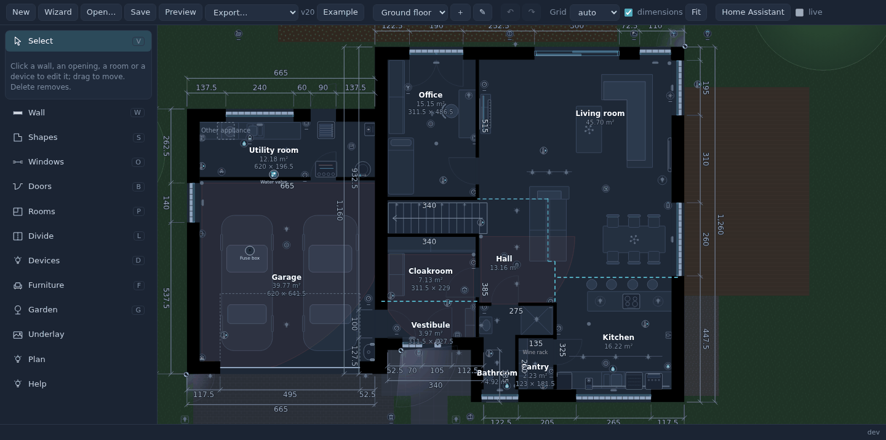
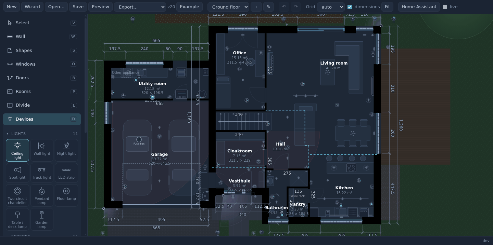

# Getting started

From nothing to your house live on a dashboard. Plan on 15 minutes for a simple house, an evening for a detailed one.

## 1. Install

**HACS** (recommended):

1. HACS → ⋮ → **Custom repositories** → `https://github.com/stryczekk/living-floorplan`, type **Integration**.
2. Find **Living Floor Plan** in HACS, download it, **restart Home Assistant**.
3. *Settings → Devices & services → **Add integration** → Living Floor Plan* (no questions asked).

**Manually:** copy `custom_components/living_floorplan/` into your `config/custom_components/`, restart, then step 3.

What you get:

- **Floor plan** in the sidebar - the editor (administrators only);
- the card `custom:living-floorplan-card` on every dashboard - no resource to add.

## 2. Draw the walls

Open **Floor plan** from the sidebar. It signs in with your Home Assistant login, so the entity fields suggest your own
entities. Three ways to start:

- **Wizard** - a rectangle and a few rooms from their sizes ("a house in 5 minutes"), then adjust;
- **Example** - a made-up two-storey house to look around and learn from;
- **from your drawing** - *Underlay* puts a photo, a scan or a **PDF** of your plan under the editor; set its scale with
  two points a known distance apart, then trace the walls over it.

Walls: the **Wall** tool (W), click the corners; type a length while drawing to set it exactly. A wall that ends on
another wall joins it (also when you end it a little short or a little past - it reaches the other wall's face).
Pick the wall type (exterior, load-bearing, partition) and the thickness in *Wall types* in the tool.



## 3. Openings and rooms

- **Windows** (O) and **Doors** (B): click a wall where it goes. Windows with one or more panes, sliding, balcony doors,
  corner windows; doors single, double, sliding, pocket, garage, gates, passages. Give a window its **cover** and its
  **contact sensor**, a door its contact - the card then knows when it is open (and a closed door stops the light).
- **Rooms** (F) appear by themselves once the walls close a space: click one to name it. An open-plan space is split by
  a **Divide** line (L). The area is shown as you go.

## 4. Lights and devices

The **Devices** tool (D) has a palette in groups: lights, sensors, security, climate, outside, energy, appliances, audio
& video, network, other, notes.

- A **light** is a circuit: one entity, and its bulbs where they really are (add bulbs to one circuit with Shift + click).
  A two-circuit **chandelier** is one lamp with two entities and the number of bulbs on each circuit.
- **Sensors** (presence, motion, temperature, smoke, leak, CO₂...), **thermostats**, **cameras** (drag their field of
  view), **locks**, **appliances** (washer, dryer, fridge, dishwasher...), the **TV**, the **A/C**: place them and pick
  their entity. The entity field only suggests entities of that kind.
- A device by a wall turns its back to it by itself (Alt while dragging: always to the wall); R turns it.



## 5. Save

**Save** keeps the plan in Home Assistant. *Save as new version* (with a note) keeps the previous one; any version can
be opened again. Nothing to copy anywhere.

Optional, in **Plan**: the **start view** - zoom the editor to the part of the plan the card should open on (e.g. the
house without the garden) and press *Set to what I see*.

## 6. The card

Edit a dashboard → *Add card* → **Living Floor Plan** (or YAML):

```yaml
type: custom:living-floorplan-card
```

No options are needed: it shows the plan saved in the editor and redraws when you save a new version. Administrators
get *✎ Edit the plan* in its ⚙ menu.

Next: [what the card does](card.md), [the options](configuration.md), and [the history dialogs and long-range history
with our other add-ons](companions.md).
